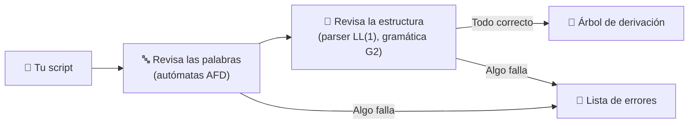

<div align="center">

```
███╗   ██╗███████╗████████╗██████╗ ██╗   ██╗███╗   ██╗███╗   ██╗███████╗██████╗
████╗  ██║██╔════╝╚══██╔══╝██╔══██╗██║   ██║████╗  ██║████╗  ██║██╔════╝██╔══██╗
██╔██╗ ██║█████╗     ██║   ██████╔╝██║   ██║██╔██╗ ██║██╔██╗ ██║█████╗  ██████╔╝
██║╚██╗██║██╔══╝     ██║   ██╔══██╗██║   ██║██║╚██╗██║██║╚██╗██║██╔══╝  ██╔══██╗
██║ ╚████║███████╗   ██║   ██║  ██║╚██████╔╝██║ ╚████║██║ ╚████║███████╗██║  ██║
╚═╝  ╚═══╝╚══════╝   ╚═╝   ╚═╝  ╚═╝ ╚═════╝ ╚═╝  ╚═══╝╚═╝  ╚═══╝╚══════╝╚═╝  ╚═╝
```

### 🕶️ El lenguaje para escribir ciberataques… *de mentiras*

**Un mini-lenguaje (DSL) para simular secuencias de escaneo, intrusión y evasión de defensas,<br>con su propio analizador léxico y sintáctico.**


-00C853?style=for-the-badge)


</div>

---

## ⚡ ¿Qué es NetRunner?

Imagina un videojuego *cyberpunk* donde eres un hacker que planea su incursión a un servidor enemigo.
**NetRunner** te deja escribir ese plan como si fuera un programa: eliges el objetivo, encadenas acciones y tomas decisiones según las defensas que encuentres.

> 🎮 **Es 100 % simulación.** Nada se conecta a ninguna red: el programa solo *lee* tu script y te dice si está bien escrito.

---

## 💻 Así se ve un script

```text
// Incursión al nodo enemigo
TARGET NODE 0xA1 {
    SCAN PORTS -> CONNECT PORT 22;

    IF FIREWALL == ACTIVE THEN {
        BYPASS FIREWALL;
    } ELSE {
        INJECT PAYLOAD "rootkit";
    }

    EXFIL DATA -> CLEAR LOGS;
}
```

| Pieza | Qué significa |
|:---:|---|
| 🎯 `TARGET NODE 0xA1` | El servidor que vas a atacar (dirección hexadecimal). Uno por script |
| 🔗 `->` | Encadena acciones: *haz esto, luego esto* |
| 🧠 `IF … THEN … ELSE` | Decide según el firewall (`FIREWALL == ACTIVE`) o el nivel de seguridad (`ICE_LEVEL > 3`). El `ELSE` es opcional |
| 🧱 `{ }` | Agrupan un bloque con al menos una instrucción |
| ✅ `;` | Cierra cada instrucción |
| 💬 `//` | Comentarios, el programa los ignora |

> Las 23 palabras del lenguaje van siempre en **MAYÚSCULAS**: `scan` es un error.

---

## 🧰 Arsenal de acciones

<div align="center">

| | Acción | | Acción |
|:---:|---|:---:|---|
| 📡 | `SCAN PORTS` | 💉 | `INJECT PAYLOAD "…"` |
| 🔌 | `CONNECT PORT 22` | 📜 | `EXECUTE SCRIPT "…"` |
| 🛡️ | `BYPASS FIREWALL` | 📦 | `EXFIL DATA` |
| 🔥 | `DISABLE FIREWALL` | 🧹 | `CLEAR LOGS` |

</div>

---

## 🔍 ¿Qué hace el programa?

Le das un archivo con tu script y lo revisa en dos pasadas, como lo haría un compilador real:



### 🌳 Si tu script es válido…
Obtienes el **árbol de derivación**: el "mapa" que muestra cómo se arma tu script paso a paso según las reglas R1–R28 de la gramática, con los nodos primados (`'`) y las reglas vacías (`ε`).
Por ejemplo, para `TARGET NODE 0xA1 { SCAN PORTS -> CONNECT PORT 22; }` escrito en tres líneas (cada hoja indica su tipo y su `@línea:columna`):

```text
<programa>
├── TARGET [TK_CMD @1:1]
├── NODE [TK_CMD @1:8]
├── 0xA1 [HEX_ADDR @1:13]
└── <bloque>
    ├── { [TK_IZQ @1:18]
    ├── <lista_instr>
    │   ├── <instruccion>
    │   │   ├── <secuencia>
    │   │   │   ├── <accion>
    │   │   │   │   ├── SCAN [TK_CMD @2:5]
    │   │   │   │   └── PORTS [TK_CMD @2:10]
    │   │   │   └── <secuencia'>
    │   │   │       ├── -> [TK_OP @2:16]
    │   │   │       ├── <accion>
    │   │   │       │   ├── CONNECT [TK_CMD @2:19]
    │   │   │       │   ├── PORT [TK_CMD @2:27]
    │   │   │       │   └── 22 [TK_NUM @2:32]
    │   │   │       └── <secuencia'>
    │   │   │           └── ε
    │   │   └── ; [TK_DELIM @2:34]
    │   └── <lista_instr'>
    │       └── ε
    └── } [TK_DER @3:1]
```

### 🚨 Si algo está mal…
Te dice **qué** falló y **dónde** (línea:columna), sin quedarse en el primer error:

```text
Se encontraron 2 error(es):
[Léxico] 2:16  Símbolo '@' no pertenece al alfabeto de NetRunner
[Sintáctico] 5:5  Se esperaba ';' o '->', pero se encontró '}'
```

---

## 🚀 Pruébalo

```bash
python main.py examples/ok_1_completo.nr     # analiza el archivo en la consola
python main.py                               # abre la interfaz gráfica
```

> Cambia la ruta por el archivo que quieras analizar. En `examples/` hay scripts válidos (`ok_*.nr`) y con errores (`error_*.nr`). ¡Intenta romperlo a propósito y mira qué errores te muestra! 😈

---

## 🎓 Sobre el proyecto

Proyecto final de **Teoría de Lenguajes Formales** en la **Universidad del Quindío**, construido en tres fases:

| Fase | Qué se hizo |
|:---:|---|
| 🔤 **1. Léxico** | El alfabeto, las palabras y los autómatas que las reconocen |
| 🧩 **2. Sintaxis** | La gramática que define cómo se combinan las palabras |
| ⚙️ **3. Parser** | El programa que pone todo eso a funcionar |

<div align="center">

**Hecho por**

Miguel Ángel Vargas Pelaez · Willinton Vergara Cataño · Juan Pablo López Gómez

*Profesora: Ana María Tamayo Ocampo*

<br/>

`> CONEXIÓN FINALIZADA_ ▌`

</div>
